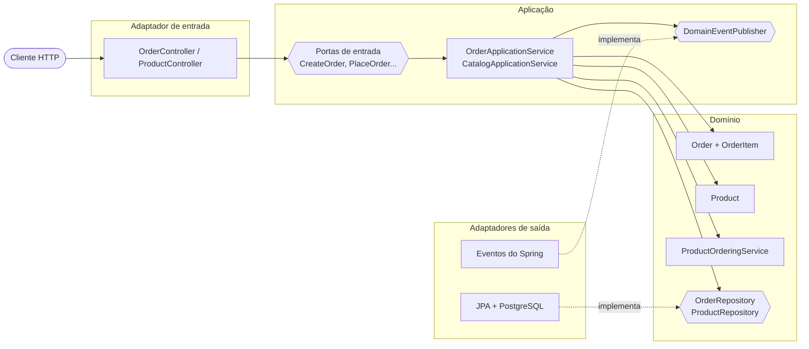

# ddd-hexagonal

Domain-Driven Design (tático) e Arquitetura Hexagonal em uma API de pedidos, com Java 25 e Spring Boot 4.

Lab da **Fase 1** da Pós Tech Software Architecture (FIAP): **Domain Driven Design**, **Arquitetura Hexagonal**, **Qualidade de Software** e **Desenvolvimento Seguro**. O código é original, escrito para praticar os conceitos; não é material do curso. As notas de estudo ficam em [pos-tech-software-architecture](https://github.com/geancgbr/pos-tech-software-architecture/blob/notas/P%C3%B3s%20Tech%20-%20Software%20Architecture/Fase%201%20-%20Arquitetura%20de%20Software/Domain%20Driven%20Design/Domain%20Driven%20Design.md).

## O que o lab mostra

| Conceito | Onde está no código | Nota |
|---|---|---|
| Objeto de Valor | `Money`, `Quantity`, `OrderId`, `CustomerId`: records imutáveis, iguais por valor, que se validam na criação | [Objeto de Valor](https://github.com/geancgbr/pos-tech-software-architecture/blob/notas/P%C3%B3s%20Tech%20-%20Software%20Architecture/Fase%201%20-%20Arquitetura%20de%20Software/Conceitos/Objeto%20de%20Valor.md) |
| Entidade | `OrderItem` (identidade dentro do pedido) e `Product` | [Entidade](https://github.com/geancgbr/pos-tech-software-architecture/blob/notas/P%C3%B3s%20Tech%20-%20Software%20Architecture/Fase%201%20-%20Arquitetura%20de%20Software/Conceitos/Entidade.md) |
| Agregado | `Order` é a raiz: itens só mudam por ela, e as regras valem sempre | [Agregado](https://github.com/geancgbr/pos-tech-software-architecture/blob/notas/P%C3%B3s%20Tech%20-%20Software%20Architecture/Fase%201%20-%20Arquitetura%20de%20Software/Conceitos/Agregado.md) |
| Serviço de Domínio | `ProductOrderingService`: a regra envolve dois agregados (`Product` e `Order`) | [Serviço de Domínio](https://github.com/geancgbr/pos-tech-software-architecture/blob/notas/P%C3%B3s%20Tech%20-%20Software%20Architecture/Fase%201%20-%20Arquitetura%20de%20Software/Conceitos/Servi%C3%A7o%20de%20Dom%C3%ADnio.md) |
| Evento de Domínio | `OrderCreated`, `OrderPlaced`, `OrderCancelled`, publicados depois de salvar | [Evento de Domínio](https://github.com/geancgbr/pos-tech-software-architecture/blob/notas/P%C3%B3s%20Tech%20-%20Software%20Architecture/Fase%201%20-%20Arquitetura%20de%20Software/Conceitos/Evento%20de%20Dom%C3%ADnio.md) |
| Repositório | `OrderRepository` e `ProductRepository` são do domínio; a implementação JPA é um adaptador | [Camadas do DDD](https://github.com/geancgbr/pos-tech-software-architecture/blob/notas/P%C3%B3s%20Tech%20-%20Software%20Architecture/Fase%201%20-%20Arquitetura%20de%20Software/Conceitos/Camadas%20do%20DDD.md) |
| Portas e Adaptadores | portas de entrada em `application.port.in`, de saída em `application.port.out` e nos repositórios; adaptadores em `adapter.in.web` e `adapter.out` | [Arquitetura Hexagonal](https://github.com/geancgbr/pos-tech-software-architecture/blob/notas/P%C3%B3s%20Tech%20-%20Software%20Architecture/Fase%201%20-%20Arquitetura%20de%20Software/Conceitos/Arquitetura%20Hexagonal.md) |
| Inversão de Controle | domínio e aplicação não usam Spring; `config.UseCaseConfig` liga as implementações | [ARQ 05](https://github.com/geancgbr/pos-tech-software-architecture/blob/notas/P%C3%B3s%20Tech%20-%20Software%20Architecture/Fase%201%20-%20Arquitetura%20de%20Software/Arquitetura%20de%20Software/Aulas/ARQ%2005%20-%20Arquitetura%20Hexagonal.md) |
| Contexto Delimitado | um contexto (Vendas); `Product` ficaria num contexto de Catálogo num sistema real | [Contexto Delimitado](https://github.com/geancgbr/pos-tech-software-architecture/blob/notas/P%C3%B3s%20Tech%20-%20Software%20Architecture/Fase%201%20-%20Arquitetura%20de%20Software/Conceitos/Contexto%20Delimitado.md) |

## Arquitetura



As dependências apontam sempre para o centro. O teste `HexagonalArchitectureTest` (ArchUnit) quebra o build se o domínio ou a aplicação passarem a depender de Spring, JPA ou de um adaptador.

```
src/main/java/io/github/geancgbr/orders
├── domain
│   ├── shared        Money, Quantity, DomainEvent, DomainException
│   ├── order         Order, OrderItem, eventos, OrderRepository, ProductOrderingService
│   └── product       Product, ProductRepository
├── application
│   ├── port/in       casos de uso
│   ├── port/out      DomainEventPublisher
│   └── service       OrderApplicationService, CatalogApplicationService
├── adapter
│   ├── in/web        REST e tratamento de erros (Problem Details)
│   └── out           persistence (JPA) e events (Spring)
└── config            ligação das portas com as implementações
```

## Regras de negócio

- Um pedido nasce como rascunho (`DRAFT`), é fechado (`PLACED`) ou cancelado (`CANCELLED`).
- Só um rascunho aceita itens; no máximo 10 produtos diferentes por pedido.
- Adicionar o mesmo produto de novo soma a quantidade e mantém o preço do primeiro registro.
- Quantidade entre 1 e 99; valores monetários não podem ser negativos.
- Produto inativo não entra no pedido.
- Pedido sem itens não pode ser fechado; cancelamento exige motivo e acontece uma vez.
- Cupom: um por pedido, só em rascunho com itens, de 1% a 50% sobre o subtotal, arredondado em centavos. Cupons válidos: `BEMVINDO10` e `BLACKFRIDAY25`.

Violação de regra vira `422` com a mensagem do domínio; recurso inexistente vira `404`.

## Qualidade de Software

| Aula | Onde está no projeto |
|---|---|
| [QS 01 – Principais conceitos](https://github.com/geancgbr/pos-tech-software-architecture/blob/notas/P%C3%B3s%20Tech%20-%20Software%20Architecture/Fase%201%20-%20Arquitetura%20de%20Software/Qualidade%20de%20Software/Aulas/QS%2001%20-%20Principais%20conceitos.md) | **Caixa branca**: `OrderAddItemWhiteBoxTest` (um teste por caminho do código) e `InputValidationWhiteBoxTest`, com cobertura de ramos medida pelo JaCoCo; o build exige 90% de ramos cobertos no domínio. **Caixa preta**: `OrderApiBlackBoxTest`, só entradas e saídas HTTP, com valores-limite de quantidade (0, 1, 99, 100) |
| [QS 02 – Testes de unidade](https://github.com/geancgbr/pos-tech-software-architecture/blob/notas/P%C3%B3s%20Tech%20-%20Software%20Architecture/Fase%201%20-%20Arquitetura%20de%20Software/Qualidade%20de%20Software/Aulas/QS%2002%20-%20Testes%20de%20unidade.md) | Testes do domínio em JUnit 5 + AssertJ, isolados e rápidos, no formato Arrange / Act / Assert. A aula usa NUnit, xUnit e MSTest (.NET); `@Test` equivale a `[Test]` / `[Fact]` / `[TestMethod]` |
| [QS 03 – TDD](https://github.com/geancgbr/pos-tech-software-architecture/blob/notas/P%C3%B3s%20Tech%20-%20Software%20Architecture/Fase%201%20-%20Arquitetura%20de%20Software/Qualidade%20de%20Software/Aulas/QS%2003%20-%20Aplicando%20TDD%20na%20pr%C3%A1tica.md) | O **cupom de desconto** foi feito em três ciclos Red-Green-Refactor. Cada etapa é um commit marcado com `[TDD vermelho]`, `[TDD verde]` ou `[TDD refatoração]` no [histórico](https://github.com/geancgbr/ddd-hexagonal/commits/trunk) |
| [QS 04 – Testes de integração](https://github.com/geancgbr/pos-tech-software-architecture/blob/notas/P%C3%B3s%20Tech%20-%20Software%20Architecture/Fase%201%20-%20Arquitetura%20de%20Software/Qualidade%20de%20Software/Aulas/QS%2004%20-%20Testes%20de%20integra%C3%A7%C3%A3o.md) | Ambiente semelhante ao de produção com **Testcontainers** (PostgreSQL real). Bottom-up: `JpaOrderRepositoryAdapterTest` testa o adaptador de persistência sozinho; depois a API inteira em `OrderApiBlackBoxTest`. Os testes de aplicação usam adaptadores falsos em memória (`support/InMemoryAdapters`) |
| [QS 05 – BDD](https://github.com/geancgbr/pos-tech-software-architecture/blob/notas/P%C3%B3s%20Tech%20-%20Software%20Architecture/Fase%201%20-%20Arquitetura%20de%20Software/Qualidade%20de%20Software/Aulas/QS%2005%20-%20Trabalhando%20com%20BDD.md) | Cenários em **Gherkin em português** (`src/test/resources/features`), executados com **Cucumber**: especificação viva na linguagem ubíqua. Relatório em `target/cucumber/relatorio.html` |
| [QS 06 – Testes de carga](https://github.com/geancgbr/pos-tech-software-architecture/blob/notas/P%C3%B3s%20Tech%20-%20Software%20Architecture/Fase%201%20-%20Arquitetura%20de%20Software/Qualidade%20de%20Software/Aulas/QS%2006%20-%20Testes%20de%20carga.md) | **k6** com o fluxo de compra completo: `load-tests/carga.js` (uso esperado, p95 < 300 ms e menos de 1% de erros) e `load-tests/estresse.js` (até 500 usuários virtuais, para achar o ponto de degradação) |

```bash
make test       # 73 testes + formatação, cobertura e análise estática
make coverage   # abre o relatório de cobertura do JaCoCo
make up         # sobe a aplicação
make load       # teste de carga com k6 (roda em container)
make stress     # teste de estresse com k6
```

## Desenvolvimento Seguro

| Aula | Onde está no projeto |
|---|---|
| [DS 01 – Security by Design](https://github.com/geancgbr/pos-tech-software-architecture/blob/notas/P%C3%B3s%20Tech%20-%20Software%20Architecture/Fase%201%20-%20Arquitetura%20de%20Software/Desenvolvimento%20Seguro/Aulas/DS%2001%20-%20Vulnerabilidades%2C%20ataques%20e%20intrus%C3%B5es.md) | **Validação de entrada** por lista de caracteres permitidos (`InputRules`) e limites de tamanho. **Menor privilégio**: a aplicação usa o usuário `orders_app`, que só lê e grava dados; quem cria e altera tabelas é `orders_owner`, só nas migrações (`db/init/01-roles.sql`, conferido por `make privileges`); o container roda sem root. **Segmentação de rede**: o PostgreSQL fica numa rede interna, sem porta exposta. **Teste de segurança contínuo**: `SecurityBlackBoxTest` e SpotBugs rodam em todo build |
| [DS 02 – Buffer overflow, XSS e SQL Injection](https://github.com/geancgbr/pos-tech-software-architecture/blob/notas/P%C3%B3s%20Tech%20-%20Software%20Architecture/Fase%201%20-%20Arquitetura%20de%20Software/Desenvolvimento%20Seguro/Aulas/DS%2002%20-%20Buffer%20overflows%2C%20cross-site%20scripting%20e%20SQL%20injection.md) | **SQL Injection**: a busca `GET /products?name=` usa consulta parametrizada (Spring Data); o teste envia `' OR '1'='1`, `DROP TABLE` e `UNION SELECT` e confirma que viram texto comum. **XSS**: HTML e script no nome são recusados com 400 sem devolver o conteúdo enviado; a API só responde JSON, com `Content-Security-Policy: default-src 'none'` e `X-Content-Type-Options: nosniff`. **Buffer overflow**: a JVM checa os limites de memória; os campos ainda têm tamanho máximo |
| [DS 03 – Bibliotecas de software](https://github.com/geancgbr/pos-tech-software-architecture/blob/notas/P%C3%B3s%20Tech%20-%20Software%20Architecture/Fase%201%20-%20Arquitetura%20de%20Software/Desenvolvimento%20Seguro/Aulas/DS%2003%20-%20Bibliotecas%20de%20software.md) | **SBOM** no formato CycloneDX (`make sbom`, gera `target/bom.json`). **Vulnerabilidades**: `make deps` varre o SBOM com Trivy e falha se houver HIGH ou CRITICAL (resultado: 0). **Licenças**: `make licenses`; das 99 dependências, o Trivy aponta como restritas o Logback (LGPL-2.1) e duas APIs Jakarta (GPL-2.0 com *classpath exception*). As duas têm licença dupla, com EPL como alternativa, e a exceção de classpath permite usar a biblioteca sem que a GPL alcance o projeto |
| [DS 04 – Análise estática de código](https://github.com/geancgbr/pos-tech-software-architecture/blob/notas/P%C3%B3s%20Tech%20-%20Software%20Architecture/Fase%201%20-%20Arquitetura%20de%20Software/Desenvolvimento%20Seguro/Aulas/DS%2004%20-%20An%C3%A1lise%20est%C3%A1tica%20de%20c%C3%B3digo.md) | **SpotBugs + FindSecBugs** no `make test`. Achados tratados: `CT_CONSTRUCTOR_THROW` (corrigido: classes do domínio `final`), `SPRING_CSRF_PROTECTION_DISABLED` e `EI_EXPOSE_REP2` (aceitos com justificativa, em `spotbugs-exclude.xml`). **SonarQube** com `make sonar`: Quality Gate aprovado, nota A em segurança, confiabilidade e manutenibilidade, 0 bugs, 0 vulnerabilidades, 0 code smells, 93,5% de cobertura |
| [DS 05 – OWASP e OWASP Top 10](https://github.com/geancgbr/pos-tech-software-architecture/blob/notas/P%C3%B3s%20Tech%20-%20Software%20Architecture/Fase%201%20-%20Arquitetura%20de%20Software/Desenvolvimento%20Seguro/Aulas/DS%2005%20-%20OWASP%20e%20OWASP%20Top%2010.md) | **DAST** com OWASP ZAP sobre a especificação OpenAPI da API (`make dast`, relatório em `target/zap/zap-relatorio.html`). O SBOM do `make sbom` pode ser importado no **OWASP Dependency-Track**. Mapa do Top 10 abaixo |
| [DS 06 – Padrões de segurança](https://github.com/geancgbr/pos-tech-software-architecture/blob/notas/P%C3%B3s%20Tech%20-%20Software%20Architecture/Fase%201%20-%20Arquitetura%20de%20Software/Desenvolvimento%20Seguro/Aulas/DS%2006%20-%20Padr%C3%B5es%20de%20seguran%C3%A7a.md) | As normas (ISO 27001/27002, NIST 800-53, PCI DSS, CIS) tratam da organização e da infraestrutura. No código, aparecem os controles que elas pedem: controle de acesso por menor privilégio, gestão de vulnerabilidades em componentes e testes de segurança no ciclo de desenvolvimento |

**O que o ZAP encontrou na primeira varredura** (119 verificações aprovadas, 0 falhas, 2 alertas), todos corrigidos:

| Alerta | Causa | Correção |
|---|---|---|
| Erro 500 em `GET /products?name=%00` | O byte nulo chegava ao PostgreSQL, que rejeita o caractere | O parâmetro de busca passou a ser validado com a lista de caracteres permitidos: agora responde 400 |
| Erro 500 em `GET /products?=` | O Tomcat rejeita parâmetro sem nome e o tratamento genérico devolvia 500 | `InvalidParameterException` tratada como 400 |
| Falta o cabeçalho `Cross-Origin-Resource-Policy` | Não estava configurado | `Cross-Origin-Resource-Policy: same-origin` |

Nenhum teste automatizado tinha pegado os dois erros 500. É o tipo de achado que justifica o teste dinâmico além do estático. Os casos viraram testes em `SecurityBlackBoxTest`. Na varredura seguinte, o ZAP aprovou as 120 verificações, com 0 alertas.

**Por que o CSRF está desligado**: a API é stateless, não usa sessão nem cookie, e o CSRF só explora autenticação feita por cookie do navegador. A decisão está registrada no código (`@SuppressWarnings("java:S4502")`) e no filtro do SpotBugs.

### OWASP Top 10 (2021)

| Categoria | Situação no lab |
|---|---|
| A01 Broken Access Control | ⚠️ Fora do escopo: a API não tem autenticação. Seria o próximo passo (OAuth2/JWT) |
| A02 Cryptographic Failures | ⚠️ Fora do escopo: não há dado sensível; TLS ficaria no proxy de entrada |
| A03 Injection | ✅ Consulta parametrizada, validação de entrada e testes com payloads de SQL Injection e XSS |
| A04 Insecure Design | ✅ Regras de negócio protegidas no agregado (invariantes) e testadas |
| A05 Security Misconfiguration | ✅ Cabeçalhos de segurança, Actuator só com `health` e `info`, sem usuário padrão, erros sem stack trace |
| A06 Vulnerable and Outdated Components | ✅ SBOM, Trivy e versões atuais de todas as dependências |
| A07 Identification and Authentication Failures | ⚠️ Fora do escopo (sem autenticação) |
| A08 Software and Data Integrity Failures | ➖ Parcial: o SBOM lista os componentes; não há assinatura de artefatos |
| A09 Security Logging and Monitoring Failures | ✅ Erros inesperados registrados no log sem expor detalhes ao cliente; eventos de domínio registrados |
| A10 Server-Side Request Forgery | ➖ Não se aplica: a API não busca URLs externas |

```bash
make privileges   # prova o menor privilégio do usuário da aplicação no banco
make deps         # vulnerabilidades nas dependências (Trivy)
make licenses     # licenças das dependências
make sonar        # SonarQube em http://localhost:9000 (admin/admin)
make dast         # OWASP ZAP contra a API em execução
```

## Como rodar

Pré-requisitos: Docker e JDK 25.

```bash
make up      # sobe PostgreSQL e a aplicação em http://localhost:8080
make demo    # roteiro completo: catálogo, pedido, regras violadas e eventos
make down    # derruba tudo e apaga os dados
```


## API

| Método | Caminho | Corpo |
|---|---|---|
| `POST` | `/products` | `{"name": "Teclado", "price": 349.90}` |
| `GET` | `/products?name=` | busca opcional por nome |
| `POST` | `/products/{id}/deactivate` | |
| `POST` | `/orders` | `{"customerId": "cliente-42"}` |
| `GET` | `/orders/{id}` | |
| `POST` | `/orders/{id}/items` | `{"productId": "...", "quantity": 2}` |
| `POST` | `/orders/{id}/coupon` | `{"code": "BEMVINDO10"}` |
| `POST` | `/orders/{id}/place` | |
| `POST` | `/orders/{id}/cancel` | `{"reason": "cliente desistiu"}` |

## Stack

Java 25 · Spring Boot 4.1 · Spring Data JPA · PostgreSQL 18 · Flyway · JUnit 5 · AssertJ · ArchUnit · Testcontainers · Cucumber · JaCoCo · k6 · Spring Security · SpotBugs + FindSecBugs · SonarQube · OWASP ZAP · CycloneDX · Trivy · Spotless (palantir-java-format) · Docker Compose
