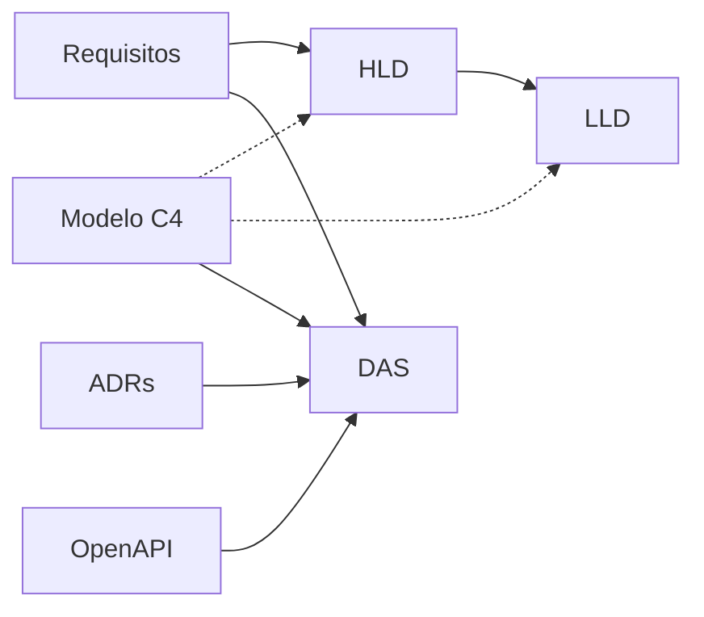

# Documentação de arquitetura

A documentação fica no repositório, ao lado do código, e muda no mesmo commit que ele ([ADR-0010](adr/0010-documentacao-como-codigo.md)).

| Documento | Para quem | O que responde |
|---|---|---|
| [Requisitos](requisitos.md) | Negócio, desenvolvimento e testes | O que o sistema faz, como deve se comportar e qual teste comprova cada item |
| [HLD](hld.md) | Stakeholders e quem chega ao projeto | Visão macro: objetivo, partes principais e como elas conversam |
| [C4](c4/README.md) | Todo o time, cada um no seu nível | Contexto, contêineres, componentes, implantação e o fluxo de aplicar cupom, gerados de um único modelo |
| [LLD](lld.md) | Quem implementa e quem revisa | Classes, estados, portas, algoritmos, sequências, erros e persistência |
| [ADRs](adr/README.md) | Quem vai mudar o sistema | Por que cada decisão importante foi tomada e o que foi descartado |
| [DAS](das.md) | Quem aprova | Documento mestre que consolida tudo e registra a aprovação |
| [OpenAPI](api/openapi.json) | Quem consome a API | Contrato dos endpoints, conferido no build |



## Comandos

```bash
make c4           # valida o modelo C4 e regenera os diagramas
make c4-local     # abre o modelo C4 no Structurizr, em http://localhost:8081
make openapi      # atualiza docs/api/openapi.json a partir da aplicação
make docs-check   # renderiza todos os diagramas Mermaid para pegar erro de sintaxe
```
