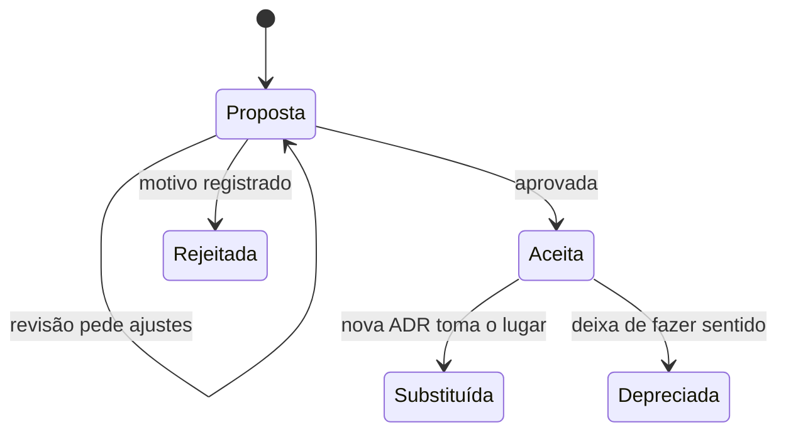

# Registro de decisões de arquitetura

Log das decisões que moldaram o projeto. Os títulos dão o contexto rápido; cada arquivo traz o contexto, a decisão, as alternativas descartadas e as consequências. O processo está descrito na [ADR-0001](0001-registrar-decisoes-com-adr.md), e novas ADRs partem do [template](template.md).

| ADR | Título | Status | Data |
|---|---|---|---|
| [0001](0001-registrar-decisoes-com-adr.md) | Registrar as decisões de arquitetura com ADRs | Aceita | 01/11/2026 |
| [0002](0002-arquitetura-hexagonal.md) | Arquitetura hexagonal com o domínio livre de framework | Aceita | 01/11/2026 |
| [0003](0003-postgresql-com-flyway.md) | PostgreSQL com o esquema versionado pelo Flyway | Aceita | 01/11/2026 |
| [0004](0004-eventos-de-dominio-em-processo.md) | Eventos de domínio publicados em processo, depois de salvar | Aceita | 01/11/2026 |
| [0005](0005-cupons-em-catalogo-em-memoria.md) | Cupons num catálogo em memória, atrás de uma porta | Aceita | 01/11/2026 |
| [0006](0006-testcontainers.md) | Testes de integração com Testcontainers | Aceita | 01/11/2026 |
| [0007](0007-menor-privilegio-no-banco.md) | Usuários separados para migrar e para operar o banco | Aceita | 01/11/2026 |
| [0008](0008-api-stateless-sem-csrf.md) | API stateless, sem proteção CSRF e com cabeçalhos de segurança | Aceita | 01/11/2026 |
| [0009](0009-autenticacao-oauth2-jwt.md) | Autenticação com OAuth2 Resource Server e JWT | Proposta | 01/11/2026 |
| [0010](0010-documentacao-como-codigo.md) | Documentação de arquitetura como código, verificada no build | Aceita | 01/11/2026 |

## Ciclo de vida

Uma ADR aceita não é editada. Para mudar a decisão, escreve-se uma ADR nova, e a antiga recebe o status Substituída, com o link para a sucessora. As ADRs servem de referência no code review: uma mudança que contrarie uma decisão aceita precisa de uma ADR nova antes.
