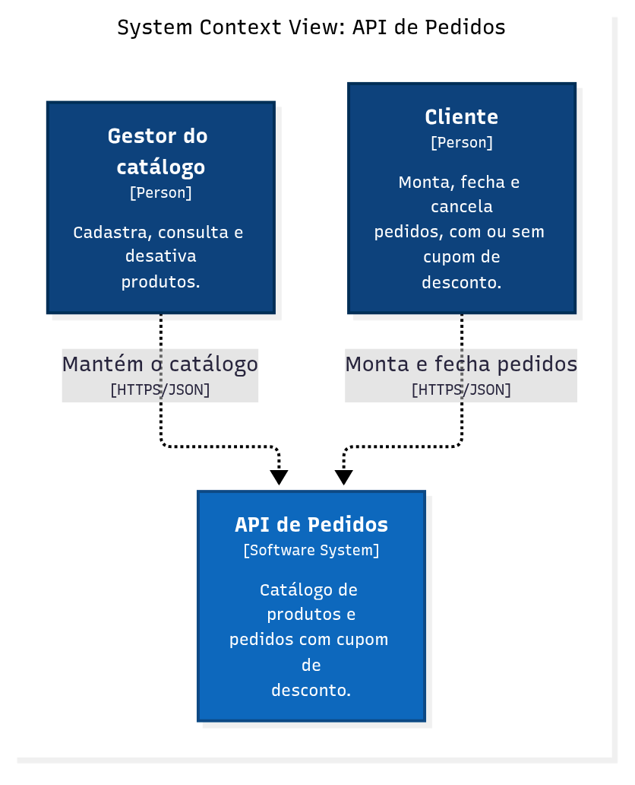
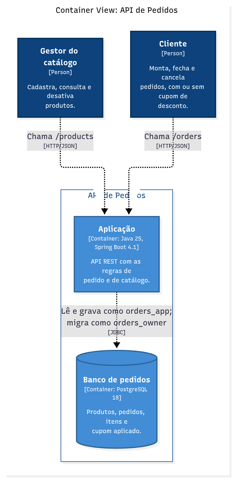
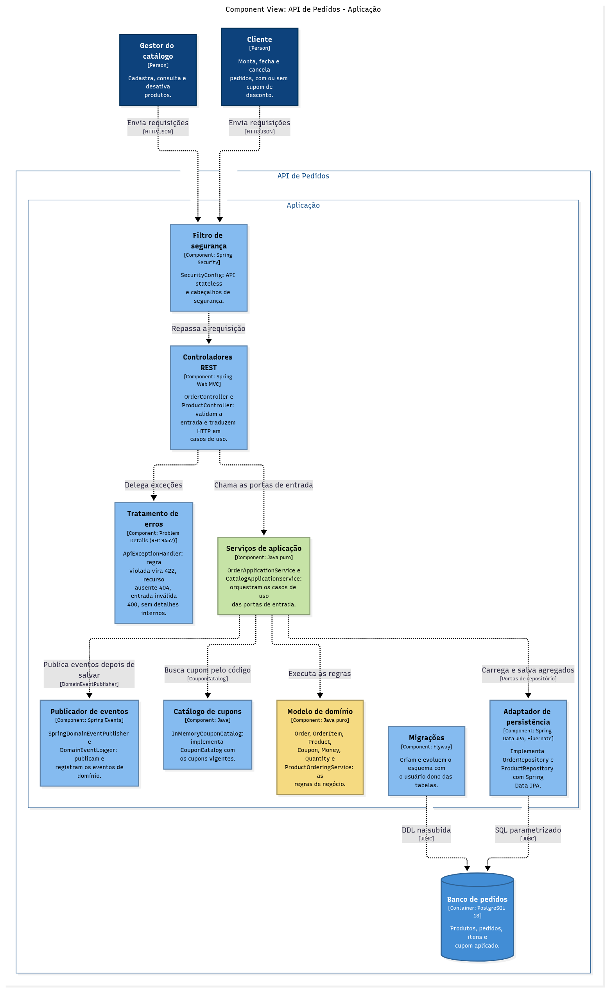
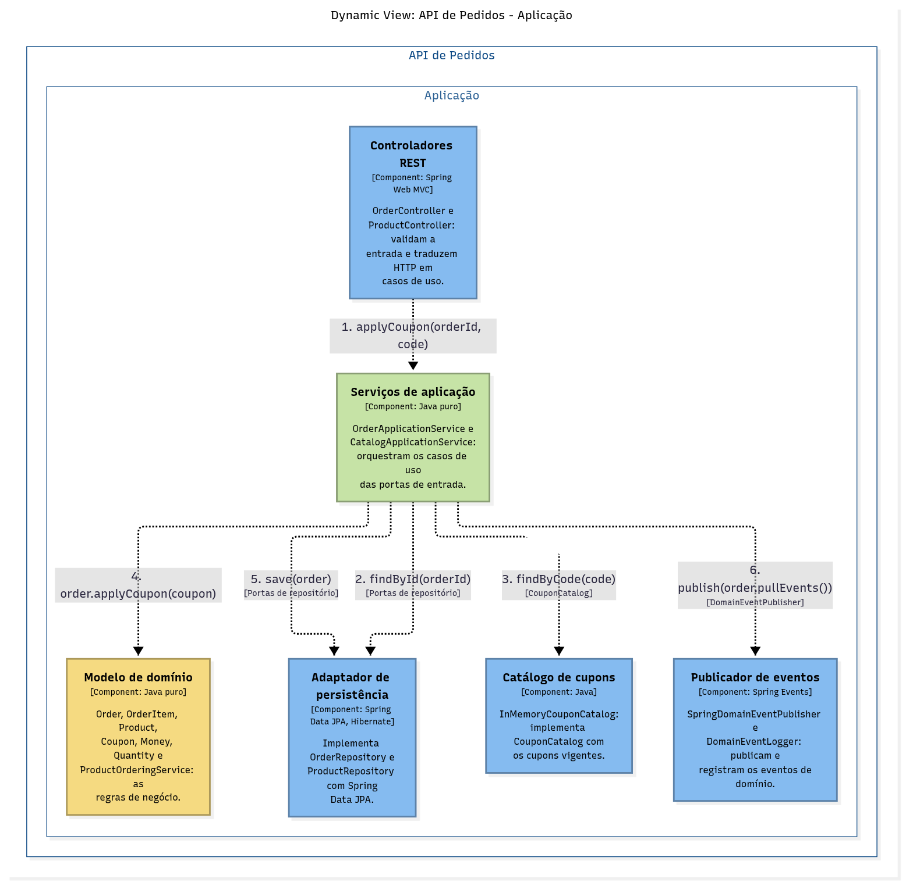
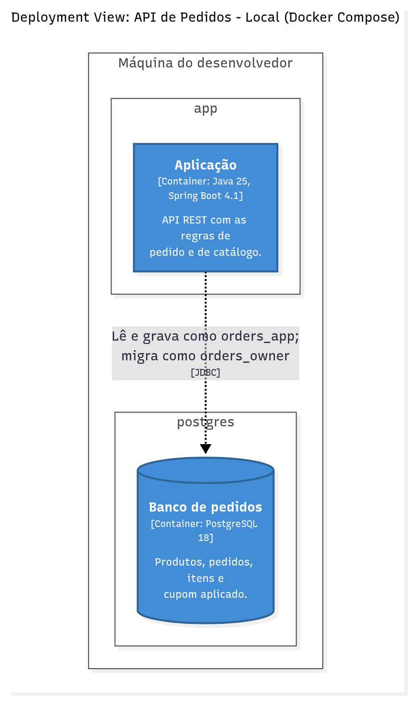

# Modelo C4

Todos os diagramas abaixo saem de um único modelo, [workspace.dsl](workspace.dsl), escrito em Structurizr DSL. Um elemento renomeado no modelo muda em todas as visões. `make c4` valida o modelo e regenera as imagens; `make c4-local` abre o modelo no Structurizr, em `http://localhost:8081`, para navegar entre as visões.

| Nível | Público | Visão |
|---|---|---|
| 1. Contexto | Negócio e qualquer pessoa | [Contexto](#contexto) |
| 2. Contêineres | Arquitetura, desenvolvimento e operação | [Contêineres](#contêineres) |
| 3. Componentes | Desenvolvimento | [Componentes](#componentes) e o fluxo [Aplicar cupom](#aplicar-cupom) |
| 4. Código | Quem implementa | Diagrama de classes no [LLD](../lld.md#1-modelo-de-domínio-c4-nível-4-código) |
| Implantação | Operação | [Implantação](#implantação) |

## Contexto

Quem usa a API de Pedidos. Não há sistemas externos: os cupons ficam num catálogo interno ([ADR-0005](../adr/0005-cupons-em-catalogo-em-memoria.md)).

## Contêineres

Uma aplicação Spring Boot e um banco PostgreSQL. A aplicação usa um usuário para ler e gravar e outro, dono do esquema, para as migrações ([ADR-0007](../adr/0007-menor-privilegio-no-banco.md)).

## Componentes

A aplicação por dentro, como portas e adaptadores ([ADR-0002](../adr/0002-arquitetura-hexagonal.md)). Em verde, a camada de aplicação; em amarelo, o domínio; em azul, os adaptadores.

## Aplicar cupom

Visão dinâmica: a ordem das chamadas entre componentes para aplicar um cupom. O mesmo fluxo, com as regras de cada decisão, está no fluxograma do [LLD](../lld.md#5-fluxograma-aplicar-cupom).

## Implantação

Implantação local com Docker Compose. O banco fica só na rede interna `backend`, sem porta publicada; a aplicação está nas duas redes e publica a porta 8080.

