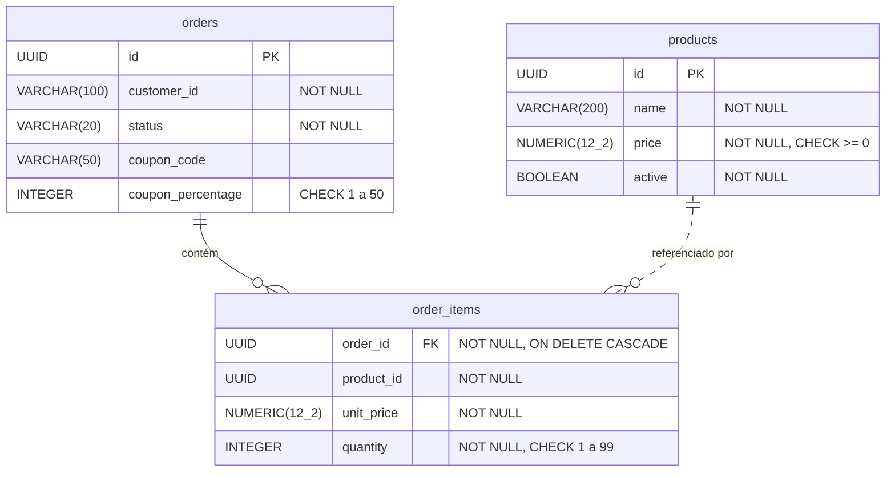

# Design Approval Sheet (DAS)

| Projeto | Versão | Data | Identificador |
|---|---|---|---|
| API de Pedidos (`ddd-hexagonal`) | 1.0 | 01/11/2026 | DAS-PEDIDOS-001 |

Documento mestre do projeto: consolida o contexto, os requisitos, a arquitetura e as decisões, e registra a aprovação antes de cada evolução. Cada seção resume e aponta para o documento detalhado.

## Aprovação

| Papel | Nome | Decisão | Data |
|---|---|---|---|
| Arquitetura e desenvolvimento | Gean Ribeiro | Aprovado | 01/11/2026 |

O lab tem um autor só. Num time, esta tabela teria uma linha por stakeholder (produto, arquitetura, segurança, operação), e cada um confirmaria a sua parte.

## Histórico

| Versão | Data | Mudança |
|---|---|---|
| 1.0 | 01/11/2026 | Primeira versão: catálogo, pedidos, cupom, qualidade e desenvolvimento seguro |

## 1. Identificação do projeto

Ver a tabela no topo. A versão do DAS muda a cada evolução aprovada; o histórico acima guarda as anteriores.

## 2. Descrição do contexto

Uma loja precisa que as regras de pedido valham para qualquer canal de venda. Hoje elas costumam ficar espalhadas entre front-end, back-end e banco, e cada canal acaba aplicando uma versão diferente. A API de Pedidos centraliza essas regras num domínio próprio, protegido de detalhes de tecnologia, e serve de base para as próximas fases do curso (contêineres, observabilidade, microsserviços).

**Objetivos**: regras de pedido corretas e testadas; resposta rápida no fluxo de compra; segurança desde o desenho; documentação que acompanha o código.

**Restrições**: Java 25 com Spring Boot 4, PostgreSQL, execução local com Docker Compose, sem ambiente em nuvem.

## 3. Requisitos e restrições

10 requisitos funcionais (catálogo, pedido, cupom, eventos) e 11 não funcionais (desempenho, escalabilidade, segurança, manutenibilidade, integridade, observabilidade, portabilidade, documentação), cada um com métrica e com o teste que o comprova.

Detalhe: [requisitos.md](requisitos.md).

## 4. Diagramas de arquitetura

| Visão | Onde |
|---|---|
| Contexto (C1) e Contêineres (C2) | [HLD](hld.md#diagrama-de-arquitetura) |
| Componentes (C3) | [c4/README.md](c4/README.md#componentes) |
| Código (C4), estados e sequência | [LLD](lld.md) |
| Fluxo dinâmico de aplicar cupom | [c4/README.md](c4/README.md#aplicar-cupom) |
| Implantação | [c4/README.md](c4/README.md#implantação) |

**Arquitetura e tecnologias**

| Camada | Escolha | Justificativa |
|---|---|---|
| Front-end | Nenhum | O lab entrega só a API; qualquer canal a consome por HTTP |
| Back-end | Java 25, Spring Boot 4.1, arquitetura hexagonal | Base dos Hands On do curso; regras isoladas do framework ([ADR-0002](adr/0002-arquitetura-hexagonal.md)) |
| Banco de dados | PostgreSQL 18 com Flyway | Dados relacionais e esquema versionado ([ADR-0003](adr/0003-postgresql-com-flyway.md)) |
| Autenticação | Nenhuma nesta versão | Proposta em [ADR-0009](adr/0009-autenticacao-oauth2-jwt.md) |
| Infraestrutura | Docker Compose com rede interna para o banco | Sobe em qualquer máquina com Docker; banco isolado ([ADR-0007](adr/0007-menor-privilegio-no-banco.md)) |

## 5. Decisões de arquitetura (ADR)

| ADR | Decisão | Status |
|---|---|---|
| [0001](adr/0001-registrar-decisoes-com-adr.md) | Registrar as decisões de arquitetura com ADRs | Aceita |
| [0002](adr/0002-arquitetura-hexagonal.md) | Arquitetura hexagonal com o domínio livre de framework | Aceita |
| [0003](adr/0003-postgresql-com-flyway.md) | PostgreSQL com o esquema versionado pelo Flyway | Aceita |
| [0004](adr/0004-eventos-de-dominio-em-processo.md) | Eventos de domínio publicados em processo, depois de salvar | Aceita |
| [0005](adr/0005-cupons-em-catalogo-em-memoria.md) | Cupons num catálogo em memória, atrás de uma porta | Aceita |
| [0006](adr/0006-testcontainers.md) | Testes de integração com Testcontainers | Aceita |
| [0007](adr/0007-menor-privilegio-no-banco.md) | Usuários separados para migrar e para operar o banco | Aceita |
| [0008](adr/0008-api-stateless-sem-csrf.md) | API stateless, sem proteção CSRF e com cabeçalhos de segurança | Aceita |
| [0009](adr/0009-autenticacao-oauth2-jwt.md) | Autenticação com OAuth2 Resource Server e JWT | Proposta |
| [0010](adr/0010-documentacao-como-codigo.md) | Documentação de arquitetura como código, verificada no build | Aceita |

**Riscos conhecidos**, aceitos nesta versão:

- Sem controle de concorrência otimista: duas alterações simultâneas no mesmo pedido terminam com a última gravação valendo.
- Um evento pode se perder se o processo cair entre salvar o pedido e publicar o evento ([ADR-0004](adr/0004-eventos-de-dominio-em-processo.md)).
- Qualquer cliente da API pode alterar qualquer pedido, porque não há autenticação ([ADR-0009](adr/0009-autenticacao-oauth2-jwt.md)).

## 6. Plano de testes e monitoramento

| Tipo | Ferramenta | O que cobre | Quando roda |
|---|---|---|---|
| Unidade (domínio) | JUnit 5, AssertJ | Regras do agregado, objetos de valor, serviço de domínio | `make test` |
| Caixa branca | JUnit 5 + JaCoCo | Cada caminho de `addItem` e das validações; build exige 90% dos ramos do domínio | `make test` |
| Aplicação | JUnit 5 com adaptadores em memória | Orquestração dos casos de uso e publicação de eventos | `make test` |
| Integração | Testcontainers (PostgreSQL 18) | Adaptador JPA e API completa com o banco real | `make test` |
| Caixa preta e valores-limite | MockMvc | Contrato HTTP, quantidades 0, 1, 99 e 100 | `make test` |
| BDD | Cucumber, Gherkin em português | Cenários de cupom e de itens na linguagem do negócio | `make test` |
| Arquitetura | ArchUnit | Dependências apontando para o domínio | `make test` |
| Contrato | `OpenApiContractTest` | OpenAPI versionado igual ao publicado | `make test` |
| Segurança | `SecurityBlackBoxTest`, SpotBugs + FindSecBugs, SonarQube, Trivy, OWASP ZAP | Injeção, XSS, cabeçalhos, vazamento de erro, dependências, DAST | `make test`, `make sonar`, `make deps`, `make dast` |
| Carga e estresse | k6 | Fluxo de compra com 20 e até 500 usuários | `make load`, `make stress` |

**Monitoramento**: `/actuator/health` informa se a aplicação e o banco estão de pé; o log registra cada evento de domínio e cada erro inesperado com o stack trace. Métricas, rastreamento e alertas ficam para a fase de Monitoramento do curso.

## 7. Modelo de dados



`order_items.product_id` não tem chave estrangeira para `products`: o item guarda o preço do momento da compra e não depende do produto continuar no catálogo. Migrações em `src/main/resources/db/migration` ([ADR-0003](adr/0003-postgresql-com-flyway.md)).

## 8. Documentação de API

Contrato OpenAPI 3.1 em [api/openapi.json](api/openapi.json), gerado pelo springdoc e conferido no build ([ADR-0010](adr/0010-documentacao-como-codigo.md)). Com a aplicação de pé, o mesmo contrato está em `http://localhost:8080/v3/api-docs`.

| Método | Caminho | Parâmetros e corpo | Sucesso | Erros |
|---|---|---|---|---|
| `POST` | `/products` | `{"name", "price"}` | 201 + `Location` | 400 |
| `GET` | `/products` | `name` opcional, até 100 caracteres | 200 | 400 |
| `POST` | `/products/{id}/deactivate` | | 204 | 404 |
| `POST` | `/orders` | `{"customerId"}` | 201 + `Location` | 400 |
| `GET` | `/orders/{id}` | | 200 | 404 |
| `POST` | `/orders/{id}/items` | `{"productId", "quantity"}` | 200 | 400, 404, 422 |
| `POST` | `/orders/{id}/coupon` | `{"code"}` | 200 | 400, 404, 422 |
| `POST` | `/orders/{id}/place` | | 200 | 404, 422 |
| `POST` | `/orders/{id}/cancel` | `{"reason"}` | 200 | 400, 404, 422 |

**Cabeçalhos**: requisições com corpo enviam `Content-Type: application/json`. Toda resposta traz `Content-Security-Policy`, `X-Content-Type-Options`, `Referrer-Policy` e `Cross-Origin-Resource-Policy` ([ADR-0008](adr/0008-api-stateless-sem-csrf.md)).

**Exemplo de resposta** (`GET /orders/{id}` de um pedido fechado com cupom):

```json
{
  "id": "5297d000-62cc-4d22-bb1c-a6ba120bc724",
  "customerId": "cliente-42",
  "status": "PLACED",
  "items": [
    {
      "productId": "64200662-31a0-4117-a73a-51bbbcd9126d",
      "unitPrice": 899.9,
      "quantity": 2,
      "subtotal": 1799.8
    }
  ],
  "couponCode": "BEMVINDO10",
  "subtotal": 1799.8,
  "discount": 179.98,
  "total": 1619.82
}
```

**Exemplo de erro** (`POST /orders/{id}/place` sem itens):

```json
{
  "detail": "Pedido sem itens não pode ser fechado",
  "instance": "/orders/5297d000-62cc-4d22-bb1c-a6ba120bc724/place",
  "status": 422,
  "title": "Regra de negócio violada"
}
```

## 9. Manual de instalação e configuração

**Pré-requisitos**: Docker com Compose e, para rodar os testes fora do container, JDK 25.

| Ambiente | Como subir | Banco |
|---|---|---|
| Desenvolvimento | `make up` (aplicação em `http://localhost:8080`) e `make down` para derrubar e apagar os dados | PostgreSQL do `compose.yaml`, criado com os papéis de `db/init` |
| Testes | `make test` | PostgreSQL descartável do Testcontainers, um por execução |
| Produção (referência) | A mesma imagem do `Dockerfile`, com as variáveis abaixo apontando para o banco gerenciado | Os papéis de `db/init/01-roles.sql` criados antes da primeira subida |

| Variável | Uso | Padrão |
|---|---|---|
| `DB_URL` | URL JDBC do banco | `jdbc:postgresql://localhost:5432/orders` |
| `DB_USER` / `DB_PASSWORD` | Usuário da aplicação, só com DML | `orders_app` |
| `SPRING_FLYWAY_USER` / `SPRING_FLYWAY_PASSWORD` | Usuário dono do esquema, usado só nas migrações | o mesmo de `DB_USER` |

As senhas do `compose.yaml` são de desenvolvimento. Em produção, viriam de um cofre de segredos, nunca do repositório.

## 10. Plano de continuidade e backup

| Situação | Ação |
|---|---|
| Aplicação cai | Reiniciar o container; a aplicação não guarda estado próprio, e o pedido continua no banco |
| Banco corrompido ou dado apagado por engano | `make restore` com o backup mais recente |
| Rotina de backup | `make backup` gera um `pg_dump` em formato custom em `backups/` (fora do Git) |
| Teste da restauração | `make backup`, alterar dados, `make restore` e conferir que os dados voltaram |

Esta versão roda numa instância só, sem réplica do banco nem balanceamento: a disponibilidade depende de reiniciar o que caiu. Em produção, o próximo passo seria um PostgreSQL gerenciado com backup automático e recuperação para um ponto no tempo.

## 11. Planos de segurança e compliance

| Tema | Situação |
|---|---|
| Autenticação e controle de acesso | Sem autenticação nesta versão ([ADR-0009](adr/0009-autenticacao-oauth2-jwt.md), proposta). No banco, menor privilégio com dois papéis ([ADR-0007](adr/0007-menor-privilegio-no-banco.md)) |
| Validação de entrada | Lista de caracteres permitidos e tamanho máximo em todos os campos de texto; consultas parametrizadas |
| Criptografia | Sem TLS na aplicação; ficaria no proxy de entrada. Nenhum dado sensível guardado |
| Dependências | SBOM CycloneDX, Trivy sem vulnerabilidades HIGH ou CRITICAL, licenças revisadas |
| Análise de código | SpotBugs + FindSecBugs no build, SonarQube com nota A, OWASP ZAP sem alertas |
| LGPD | O sistema não guarda nome, documento nem contato. `customerId` é um identificador opaco, e a validação aceita só letras, números, hífen e sublinhado. Se ele passar a identificar uma pessoa, entram base legal, prazo de retenção e atendimento aos direitos do titular |

O detalhamento, com o mapa do OWASP Top 10, está na seção Desenvolvimento Seguro do [README](../README.md#desenvolvimento-seguro).
