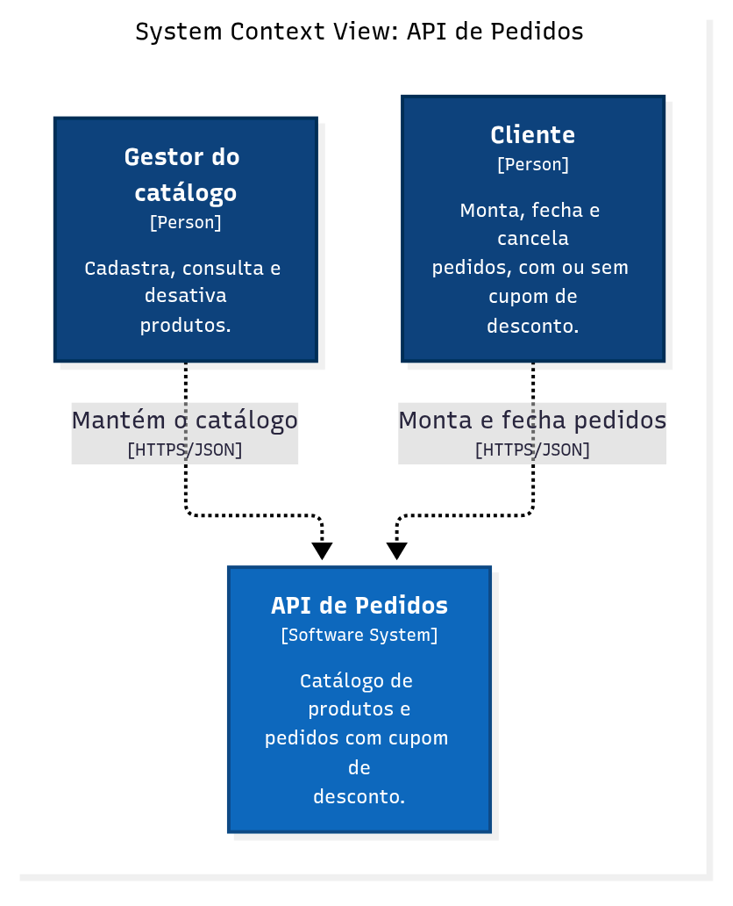
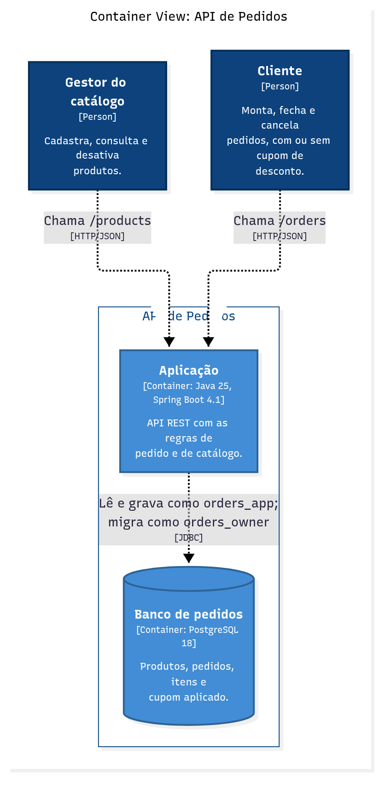

# High-Level Design (HLD)

Visão macro da API de Pedidos: o que ela faz, quem usa, quais são as partes principais e como elas conversam. Não entra em classes nem em algoritmos; isso fica no [LLD](lld.md).

## Visão geral

A API de Pedidos permite que uma loja mantenha um catálogo de produtos e que seus clientes montem pedidos, apliquem um cupom de desconto e fechem ou cancelem a compra. O valor para o negócio está em garantir as regras do pedido (limites de itens, preço do catálogo, um cupom por pedido, totais corretos) num só lugar, qualquer que seja o canal que chame a API.

**Principais funcionalidades**

- Catálogo: cadastrar, listar, buscar e desativar produtos.
- Pedido: abrir, adicionar itens, aplicar cupom, fechar, cancelar e consultar.
- Eventos: anunciar a criação, o fechamento e o cancelamento de pedidos para quem quiser reagir.

## Diagrama de arquitetura

**Contexto (C1)**: duas pessoas usam o sistema; não há sistemas externos.

**Contêineres (C2)**: uma aplicação e um banco de dados.

## Componentes em alto nível

| Componente | Responsabilidade | Tecnologia |
|---|---|---|
| Aplicação | Expõe a API REST, aplica as regras de catálogo e de pedido e publica os eventos | Java 25, Spring Boot 4.1 |
| Banco de pedidos | Guarda produtos, pedidos, itens e o cupom aplicado | PostgreSQL 18 |

**Comunicação**: os clientes chamam a aplicação por HTTP com JSON. A aplicação fala com o banco por JDBC, numa rede interna sem acesso de fora. Os eventos de domínio circulam dentro da aplicação; não há mensageria entre sistemas.

**Organização interna**: a aplicação segue a arquitetura hexagonal. As regras ficam num núcleo sem dependência de framework, e web, banco e eventos são adaptadores trocáveis ([ADR-0002](adr/0002-arquitetura-hexagonal.md)). O diagrama de componentes (C3) está em [c4/README.md](c4/README.md#componentes).

## Requisitos de alto nível

- Toda regra de pedido vale para qualquer cliente da API, sem depender de validação no front-end.
- O fluxo de compra responde rápido sob uso normal (p95 abaixo de 300 ms com 20 usuários simultâneos) e se mantém de pé sob pico (500 usuários).
- Entradas maliciosas (SQL Injection, XSS) são barradas, e a aplicação não tem poder de alterar a estrutura do banco.
- O sistema sobe com um comando em qualquer máquina com Docker.

A lista completa, com métricas e o teste que comprova cada item, está em [requisitos.md](requisitos.md).

## Fora do escopo desta versão

Autenticação ([ADR-0009](adr/0009-autenticacao-oauth2-jwt.md), proposta), alta disponibilidade, pagamento, estoque e entrega.
