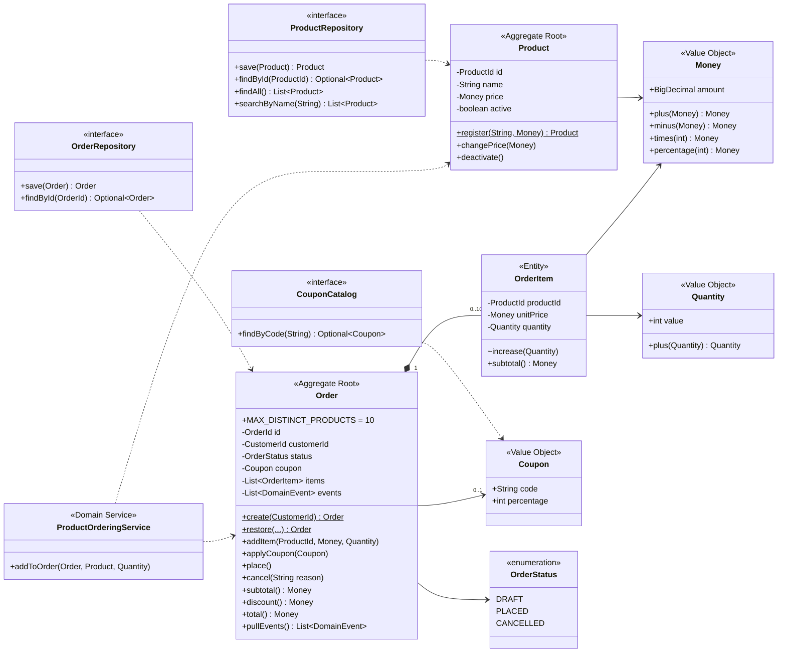
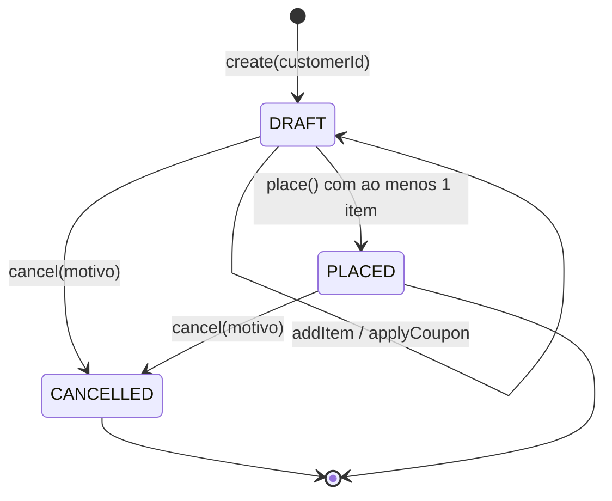
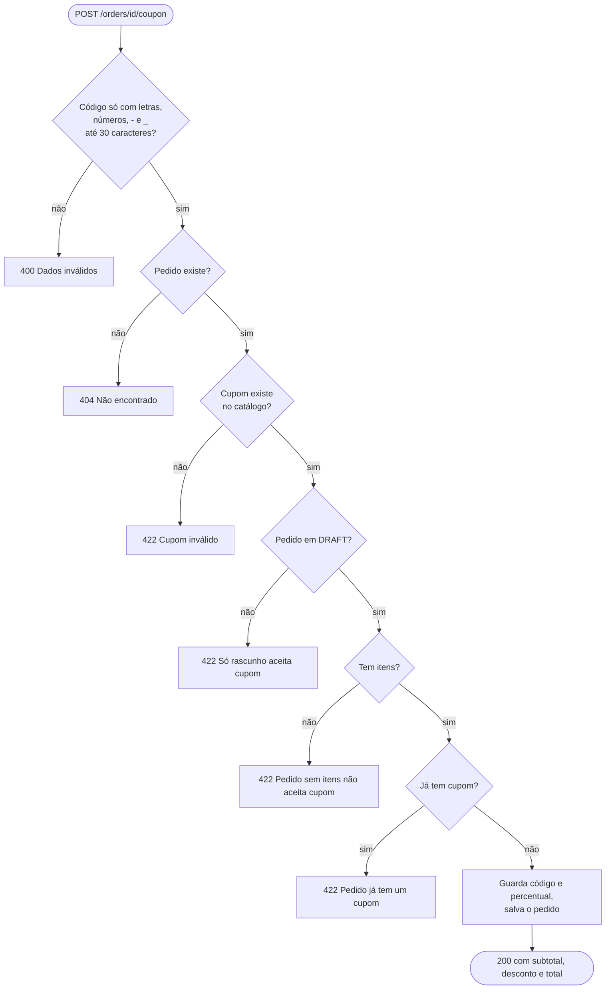
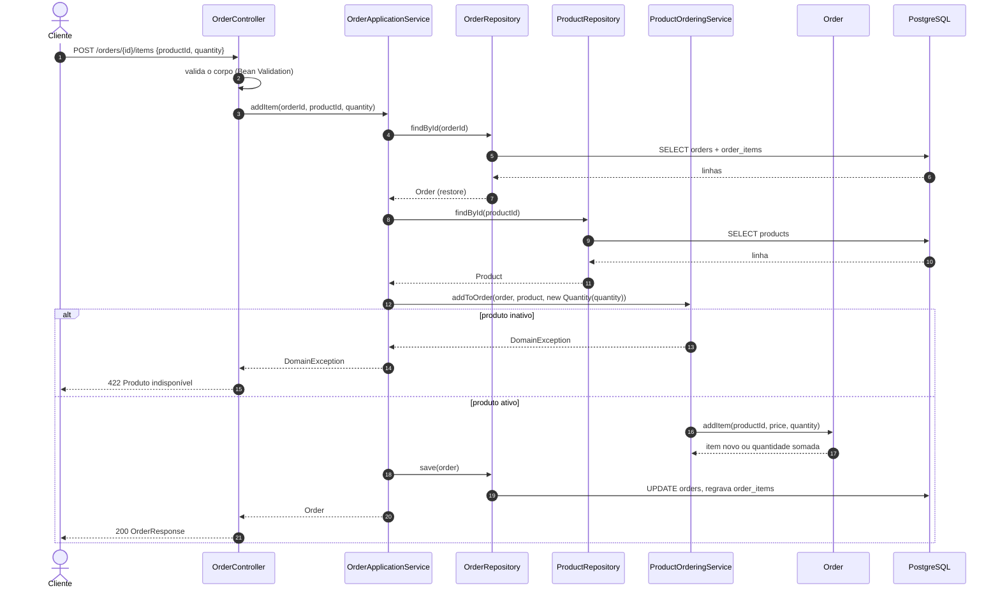
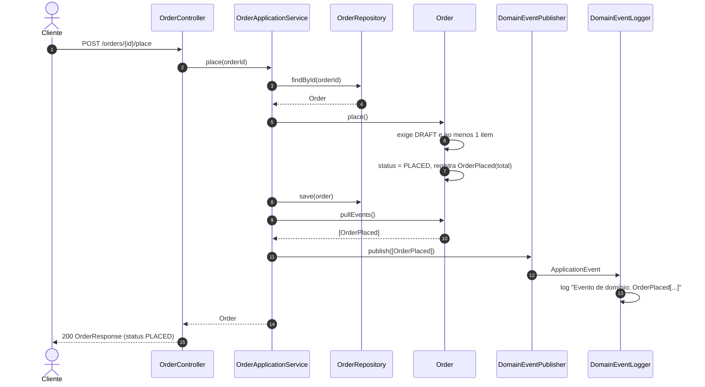

# Low-Level Design (LLD)

Detalha cada componente do [HLD](hld.md) no nível de implementação: classes, interfaces, algoritmos, fluxos e o mapeamento para o banco. É a referência para implementar e para conferir se o código segue o desenho. As decisões por trás deste desenho estão nas [ADRs](adr/README.md).

## 1. Modelo de domínio (C4 nível 4, Código)



`OrderId`, `ProductId` e `CustomerId` são objetos de valor (records) que embrulham o identificador e se validam na criação. Os eventos `OrderCreated`, `OrderPlaced` e `OrderCancelled` são records que implementam `DomainEvent`.

## 2. Ciclo de vida do pedido



| Operação | Pré-condição | Efeito | Evento |
|---|---|---|---|
| `create` | `customerId` preenchido | pedido em `DRAFT`, sem itens | `OrderCreated` |
| `addItem` | `DRAFT`; produto ativo; quantidade final de 1 a 99; até 10 produtos diferentes | novo item ou quantidade somada ao item existente, com o preço original | |
| `applyCoupon` | `DRAFT`; ao menos 1 item; sem cupom anterior | guarda código e percentual | |
| `place` | `DRAFT`; ao menos 1 item | `PLACED` | `OrderPlaced` (com o total e o número de itens) |
| `cancel` | não estar `CANCELLED`; motivo preenchido | `CANCELLED` | `OrderCancelled` (com o motivo) |

Toda pré-condição violada lança `DomainException`, que a API traduz em `422`.

## 3. Interfaces (portas)

| Porta | Tipo | Assinatura | Implementação |
|---|---|---|---|
| `CreateOrder` | entrada | `OrderId create(String customerId)` | `OrderApplicationService` |
| `AddItemToOrder` | entrada | `Order addItem(OrderId, UUID productId, int quantity)` | `OrderApplicationService` |
| `ApplyCoupon` | entrada | `Order applyCoupon(OrderId, String couponCode)` | `OrderApplicationService` |
| `PlaceOrder` | entrada | `Order place(OrderId)` | `OrderApplicationService` |
| `CancelOrder` | entrada | `Order cancel(OrderId, String reason)` | `OrderApplicationService` |
| `GetOrder` | entrada | `Order get(OrderId)` | `OrderApplicationService` |
| `RegisterProduct` | entrada | `Product register(String name, BigDecimal price)` | `CatalogApplicationService` |
| `DeactivateProduct` | entrada | `void deactivate(UUID productId)` | `CatalogApplicationService` |
| `ListProducts` | entrada | `List<Product> list()` | `CatalogApplicationService` |
| `SearchProducts` | entrada | `List<Product> search(String term)` | `CatalogApplicationService` |
| `OrderRepository` | saída | `save`, `findById` | `JpaOrderRepositoryAdapter` |
| `ProductRepository` | saída | `save`, `findById`, `findAll`, `searchByName` | `JpaProductRepositoryAdapter` |
| `CouponCatalog` | saída | `Optional<Coupon> findByCode(String code)` | `InMemoryCouponCatalog` |
| `DomainEventPublisher` | saída | `void publish(List<DomainEvent> events)` | `SpringDomainEventPublisher` |

## 4. Algoritmos

**Totais do pedido**

```text
subtotal = Σ (preço unitário × quantidade) de cada item
desconto = subtotal × percentual do cupom ÷ 100   (0 sem cupom)
total    = subtotal − desconto
```

`Money` guarda sempre duas casas decimais e arredonda com `HALF_EVEN` (arredondamento bancário). Exemplo de `OrderCouponTest.the_discount_is_rounded_to_cents`: 3 × R$ 33,33 = R$ 99,99; 15% de desconto dá R$ 14,9985, arredondado para R$ 15,00; total de R$ 84,99.

**Normalização de entrada**: o código do cupom passa por `strip()` e `toUpperCase(Locale.ROOT)`, então `bemvindo10` e `BEMVINDO10` são o mesmo cupom. `CustomerId` e o nome do produto também passam por `strip()`.

## 5. Fluxograma: aplicar cupom



## 6. Diagramas de sequência

### Adicionar item



### Fechar pedido e publicar o evento



O fluxo de aplicar cupom, no nível de componentes, está na visão dinâmica do [C4](c4/README.md#aplicar-cupom).

## 7. Tratamento de erros

As respostas de erro seguem Problem Details (RFC 9457) e nunca trazem stack trace nem o conteúdo enviado.

| Origem | HTTP | `title` | Observação |
|---|---|---|---|
| `DomainException` (regra violada) | 422 | Regra de negócio violada | `detail` com a mensagem do domínio |
| `NotFoundException` | 404 | Não encontrado | |
| Bean Validation do corpo ou de parâmetro | 400 | Dados inválidos | `erros`: lista de `{campo, erro}` |
| JSON malformado | 400 | Corpo inválido | |
| Parâmetro malformado (rejeitado pelo Tomcat) | 400 | Parâmetros inválidos | |
| Qualquer outra exceção | 500 | Erro interno | registrada no log com o stack trace |

## 8. Persistência

| Domínio | JPA | Tabela |
|---|---|---|
| `Order` | `OrderJpaEntity` | `orders` (`id`, `customer_id`, `status`, `coupon_code`, `coupon_percentage`) |
| `OrderItem` | `OrderItemEmbeddable`, coleção de elementos carregada junto com o pedido | `order_items` (`order_id`, `product_id`, `unit_price`, `quantity`) |
| `Product` | `ProductJpaEntity` | `products` (`id`, `name`, `price`, `active`) |

Os adaptadores convertem nos dois sentidos: `toEntity` monta a entidade JPA a partir do agregado, e `toDomain` reconstrói o agregado com `Order.restore` e `Product.restore`, sem disparar eventos. O modelo entidade-relacionamento está no [DAS](das.md#7-modelo-de-dados).
